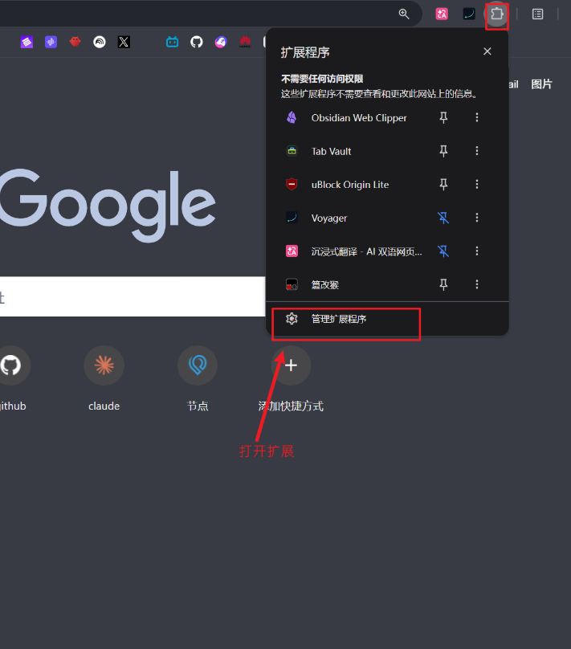
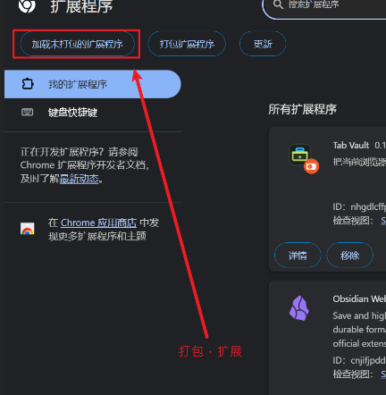

# Tab Vault

> 本地优先的 Chrome 标签工作区管理器（Chrome tab workspace manager / tab session manager）。

Tab Vault 用来处理一个很具体的时刻：你暂时离开一组研究、规划或浏览中的网页，想把窗口清空，但不想失去回到现场的能力。

它会把当前浏览器窗口保存为一个本地工作区快照，关闭原网页标签；需要时，再把整组标签恢复到新窗口。无需账号、没有云同步，工作区数据只保存在安装扩展的浏览器本地。

## 它解决什么问题

普通标签管理工具大多帮助你收集、搜索或整理标签。Tab Vault 更关注「暂时收起一整个工作现场」：

- 将当前窗口保存为不可变的工作区快照。
- 保存后立刻关闭原网页标签，真正释放窗口。
- 压缩后 10 秒内可撤销，并恢复回原窗口。
- 完整恢复会在新窗口打开，不影响你正在使用的窗口。
- 可以只恢复或删除选中的标签；工作区也支持改名、置顶、搜索和预览。
- 可以将全部或选中的工作区导出为版本化备份，导入前会预览重复、冲突、无效记录和预计空间。
- 删除的工作区会进入保留 30 天的回收站；支持批量移入、恢复和永久删除。
- 单个标签恢复失败不会阻断其他标签，并可从总览页重试失败项。
- 保存 Chrome 原生标签组，并在恢复时还原组名、颜色、折叠状态和成员关系。
- 大型工作区恢复时显示标签与标签组进度；失败标签重试后会补回原标签组。
- 备份面板支持批量置顶或取消置顶；长时间线每次只渲染 40 条，按需继续加载。
- 可以从弹窗单独压缩当前 Chrome 标签组，保留同一窗口里的其他标签。
- 可以一次保存全部普通窗口；先完整写入所有快照，成功后才关闭原网页，并支持短时多窗口撤销。
- 支持用 `Alt + Shift + V` 快捷压缩最后聚焦的普通窗口。
- 展开工作区后可一键复制带标题的可读网页清单，直接粘贴到聊天或笔记；小菜单中仍提供仅 URL 和 Markdown 格式。
- 总览页支持本地背景图和主题色，不影响标签数据的本地存储方式。
- **工作区归档折叠机制**：历史会话可一键移入「已归档」，从活跃主列表中剥离；底部提供可折叠抽屉浏览与恢复，彻底告别时间线无限长与 DOM 膨胀。
- **本地提示词看板（Prompt Vault）**：支持分类药丸筛选、关键词模糊检索、卡片管理、编辑与独立 JSON 备份/导入。
- **极速秒级复制**：在总览大看板与右上角弹窗（Popup）中，均支持点击卡片一键将提示词文本拷入剪贴板，并带有自动消退的轻提示反馈。
- **极简纯文本 UI 质感**：移除干扰视线的彩色 Emoji，回归 Linear / Raycast 级冷峻呼吸感与单色极简排版；支持 Hash 路由状态同步。

## 本地安装

Tab Vault 目前以未打包 Chrome 扩展的形式发布。

1. 克隆或下载这个仓库。

   ```bash
   git clone https://github.com/zhitaoking-maker/tab-vault.git
   ```

2. 打开 Chrome 的扩展程序菜单，点击「管理扩展程序」。

   

3. 打开右上角「开发者模式」，点击「加载已解压的扩展程序」，并选择克隆后的 `tab-vault` 文件夹。

   必须选择包含 `manifest.json` 的目录，不能选择它的上一级目录。

   

4. 你可以在 Chrome 扩展程序菜单中将 Tab Vault 固定到工具栏，方便随时压缩当前窗口。

## 使用方式

1. 点击工具栏里的 Tab Vault 图标，选择「压缩当前窗口」。
2. 当前窗口中的 HTTP/HTTPS 网页会被保存到本地，然后关闭；工作区总览会在原窗口打开。
3. 在 10 秒内点击「撤销」，可将标签恢复回原窗口。
4. 在总览中展开工作区，可预览标签、勾选后恢复或删除；点击「恢复」会将整组工作区打开到新窗口。
5. 点击「备份」可导出工作区，也可勾选时间线中的记录批量置顶、取消置顶或移入回收站。
6. 导入备份时先检查预览；确认后只合并新记录，不覆盖现有工作区。
7. 弹窗中的「压缩当前标签组」只处理活动标签所在的原生 Chrome 标签组；「保存全部窗口」会处理所有非隐身普通窗口。

默认快捷键是 `Alt + Shift + V`。如果与其他软件冲突，可以在 Chrome 的「扩展程序快捷键」页面修改。

提示词看板既可以在弹窗（Popup）中直接搜索与极速复制，也可以点击「打开总览」进入大看板进行集中维护、分类切换与备份管理。

恢复工作区不会自动删除这条记录。它会一直保留在时间线中，直到你明确删除它。

导出的备份包含网页标题和 URL，请像保存浏览历史一样妥善保管。自定义背景和外观设置不写入工作区备份。

## 隐私与权限

Tab Vault 不会将工作区数据发送到任何服务器。

| 权限 | 用途 |
| --- | --- |
| `tabs` | 读取标签的 URL、标题、顺序和固定状态；关闭已保存标签；创建恢复的标签。 |
| `tabGroups` | 读取 Chrome 原生标签组的名称、颜色和折叠状态，并在恢复时重建标签组。 |
| `storage` | 将工作区、短时撤销记录和外观设置保存到本地浏览器配置中。 |
| `alarms` | 在总览页不活跃时，仍能可靠地让 10 秒撤销操作到期。 |

扩展只保存标签级元数据，不保存网页正文、Cookie、登录状态、表单输入、滚动位置，也不会读取扩展自身本地存储以外的浏览数据。

## 开发

需要 Chrome 桌面版和较新的 Node.js 运行时。

```bash
npm test
npm run test:coverage
npm run test:dashboard
```

项目使用 Manifest V3 和原生 JavaScript。开发时可通过 `chrome://extensions` 加载项目目录。

`npm run test:dashboard` 会在隔离的无头浏览器中验证总览、弹窗、复制、批量操作和窄屏布局。`npm run test:extension` 面向允许无头加载未打包扩展的 Chromium 环境；正式版 Chrome 可能拒绝这种启动方式，因此实际加载扩展仍需要手动验收。

## 后续方向与待办项（Roadmap）

### 待优化项
- [ ] **Chrome Side Panel 常驻侧边栏适配**：在支持 Chrome 114+ 原生侧边栏的环境下，提供一键滑出侧栏的常驻看板体验。
- [ ] **提示词看板批量整理**：支持对提示词卡片进行批量归类、批量删除与标签拖拽排序。
- [ ] **键盘直达流（Keyboard Flow）**：进入弹窗后支持全局快捷键（如 `↑/↓` 选中、`Enter` 直接复制并关闭弹窗）。

### 远期实验性探索
- [ ] **网页原地唤出提示词（Slash Command `/`）**：在 AI 平台输入框内以零侵入 Shadow DOM 实验性探索原地唤出与填充（按需开启）。
- [ ] **可选的加密备份文件**：为导出的 `.tabvault.json` 提供基于 Web Crypto 的本地口令加密。
- [ ] **浏览器书签备份通道**：提供不依赖云端服务器的书签目录式第二备份机制。
- [ ] 只有在不破坏本地优先和冲突安全的前提下，才考虑可选的去中心化/自建同步。

## License

[MIT](LICENSE)
